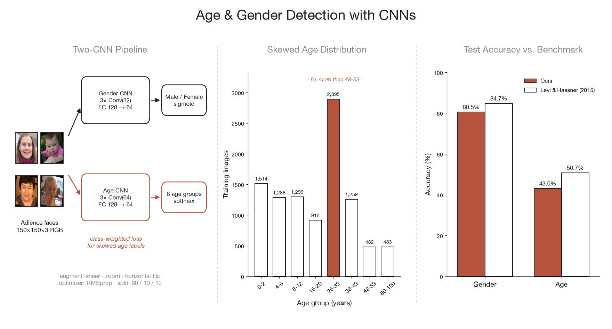
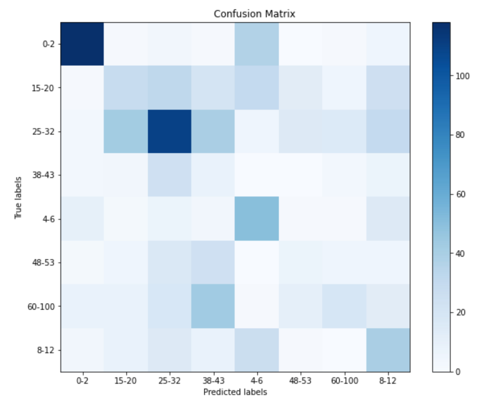
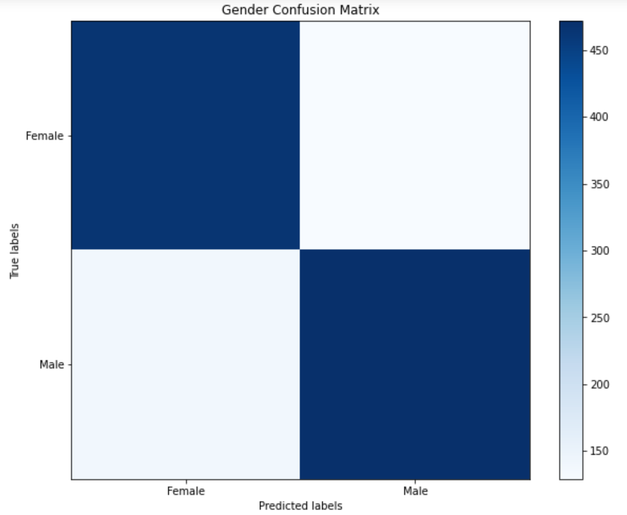

# Detecting Age and Gender through Convolutional Neural Networks


**Introduction to Machine Learning Course Project** · Kuber Shahi, Satpreet Makhija, Dhruv Khandelwal · December 2020

Can a small CNN trained on unfiltered Flickr photos tell how old someone is and whether they are male or female? This repository trains two lightweight convolutional neural networks on the [Adience](https://talhassner.github.io/home/projects/Adience/Adience-data.html) benchmark — one for binary gender classification and one for 8-way age-group classification — and compares them against the CNN of [Levi & Hassner (2015)](https://talhassner.github.io/home/projects/cnn_agegender/CVPR2015_CNN_AgeGenderEstimation.pdf), which this project follows.

## Deliverables

| Artifact | Description |
|----------|-------------|
| [Final Project Report (PDF)](reports/final_project_report.pdf) | Full write-up covering the dataset, existing approaches, CNN architectures, training choices (augmentation, class weights, early stopping), results against benchmarks, confusion-matrix analysis, and conclusions. |
| [Notebook](final_project.ipynb) | End-to-end code to build, train, and evaluate both CNNs, plot training curves and confusion matrices, and run inference on custom images. |

## Overview

Age and gender are two of the most basic attributes we read from a face, and they matter for applications such as targeted advertising, forensics, surveillance, and human-computer interaction. Inferring them from real-world photos is hard: the Adience images vary in pose, lighting, occlusion, blur, and expression.

We train **two separate CNNs** on 150×150 RGB face crops: a gender model with a sigmoid output and an age model with an 8-class softmax output. Because the age labels are heavily skewed (the 25–32 group has roughly 6× more images than 48–53 or 60–100), the age model uses a class-weighted loss.



## Project Structure

```text
.
├── data/
│   ├── folds/
│   │   └── fold_frontal_*_data.txt  # Adience fold metadata (user, image, face id, age, gender, ...)
│   ├── splits/
│   │   └── age.csv  gender.csv  # Filename, label, and train/val/test assignment used in the report
│   ├── unsegregated/            # Generated: labelled faces grouped by age group or gender (git-ignored)
│   └── {train,val,test}_{age,gender}/  # Generated: split folders the notebook reads (git-ignored)
├── scripts/
│   ├── sort_faces_by_label.py   # Sorts raw Adience faces into data/unsegregated/<task>/<label>/
│   ├── prepare_splits.py        # Builds the train/val/test folders from data/splits/*.csv
│   ├── evaluate_predictions.py  # Overall and per-class accuracy from a notebook prediction file
│   └── plot_overview.py         # Regenerates assets/imgs/project-overview.png
├── assets/
│   └── imgs/                    # project-overview.png and confusion matrices
│       └── custom/              # Drop your own photos here for inference (git-ignored)
├── reports/
│   └── final_project_report.pdf
├── outputs/                     # Trained weights and prediction files (git-ignored)
├── final_project.ipynb          # Model definitions, training, evaluation, custom inference
├── requirements.txt
├── LICENSE
└── README.md
```

## Dataset

The [Adience dataset](https://talhassner.github.io/home/projects/Adience/Adience-data.html) contains 26,580 photos of 2,284 subjects collected from Flickr, each labelled with a binary gender and one of eight age ranges. We used the near-frontal face crops (`fold_frontal_*` folds) that carry one of the eight standard age labels or a gender label — about 12,000 images per task — and split them 80% / 10% / 10% into training, validation, and test sets. The exact split is recorded in `data/splits/`.

| Split | Age images | Gender images |
|-------|-----------:|--------------:|
| Train | 10,136 | 9,699 |
| Validation | 1,038 | 1,209 |
| Test | 1,008 | 1,204 |

Age groups: `0–2`, `4–6`, `8–12`, `15–20`, `25–32`, `38–43`, `48–53`, `60–100`. The gender split is close to balanced (about 1.2 : 1), while the age split is not — see the middle panel of the overview figure.

### Getting the data

The images are not stored in this repository. Adience is distributed by its authors, who ask users to register before downloading; the photos come from Flickr and were released by their owners under Creative Commons licenses, with per-image terms in the `LICENSE.txt` that ships with the download. Please request access on the [official dataset page](https://talhassner.github.io/home/projects/Adience/Adience-data.html) and cite the authors if you use it:

> Eran Eidinger, Roee Enbar, and Tal Hassner. Age and Gender Estimation of Unfiltered Faces. *IEEE Transactions on Information Forensics and Security*, 9(12):2170–2179, 2014.

From the download, extract `faces.tar.gz` (the cropped faces, named `coarse_tilt_aligned_face.*.jpg`), then follow [Prepare the data](#prepare-the-data) below.

## Model Architecture

Both models share the same shape: stacked `Conv2D → ReLU → MaxPool(2×2) → Dropout` blocks followed by fully connected layers with dropout. They differ in filter count and output head.

| Model | Convolutional blocks | Fully connected layers | Output | Loss | Parameters |
|-------|----------------------|------------------------|--------|------|-----------:|
| **Gender CNN** | 3 × Conv2D (32 filters, 3×3) | 128 → 64 | 1 unit, sigmoid | Binary cross-entropy | 1.35M |
| **Age CNN** | 3 × Conv2D (64 filters, 3×3) | 128 → 64 | 8 units, softmax | Categorical cross-entropy (class-weighted) | 2.74M |

Dropout rates are 0.25–0.3 after every block. Both models are trained with RMSprop and batch size 32. The report's architecture section describes an earlier, deeper age model; the table above reflects the code in the notebook.

## Training Details

- **Augmentation:** `ImageDataGenerator` with shear (0.1), zoom (0.1), and horizontal flips on the training set; all splits are rescaled to [0, 1].
- **Class weights (age model):** each class gets weight `total samples / (8 × samples in class)`, so under-represented groups such as 48–53 and 60–100 contribute more to the loss.
- **Early stopping by epoch count:** validation accuracy for the age model peaked at epoch 5 and fell afterwards, so we train the age model for 5 epochs and the gender model for 6.
- **Dropout tuning:** higher dropout in the age model reduced, but did not eliminate, overfitting.

## Quick Start

### Install dependencies

```bash
python -m venv .venv && source .venv/bin/activate
pip install -r requirements.txt
```

Tested on Python 3.12 with TensorFlow 2.21, including Apple Silicon. Keras 3 no longer ships `ImageDataGenerator`, so the notebook uses the Keras 2 API through the `tf-keras` package (`import tf_keras as keras`).

### Prepare the data

After downloading Adience (see [Getting the data](#getting-the-data)), sort the faces by label and rebuild the split used in the report:

```bash
python scripts/sort_faces_by_label.py --faces /path/to/adience/faces --task age
python scripts/sort_faces_by_label.py --faces /path/to/adience/faces --task gender
python scripts/prepare_splits.py --task age
python scripts/prepare_splits.py --task gender
```

`sort_faces_by_label.py` reads the fold metadata in `data/folds/` and copies each face into `data/unsegregated/<task>/<label>/`, skipping faces with missing or non-standard age labels. `prepare_splits.py` then copies them into `data/{train,val,test}_<task>/<label>/` following `data/splits/<task>.csv`. To draw a new stratified 80/10/10 split instead, add `--random --seed <n>`.

### Train and evaluate

Open the notebook and run it top to bottom from the repository root:

```bash
jupyter notebook final_project.ipynb
```

The notebook trains both models, saves `gender_weights.h5` and `age_weights.h5` to `outputs/`, writes per-image predictions to `outputs/gender_prediction.txt` and `outputs/age_prediction.txt`, and plots accuracy, loss, and confusion matrices.

### Score the predictions

```bash
python scripts/evaluate_predictions.py outputs/gender_prediction.txt
python scripts/evaluate_predictions.py outputs/age_prediction.txt
```

Each command prints the accuracy for every class and overall.

### Predict on your own images

Put images in `assets/imgs/custom/` (or capture one from your webcam with the OpenCV cell), then run the last cell of the notebook. It prints the predicted gender and age group for each image.

### Regenerate the overview figure

```bash
python scripts/plot_overview.py
```

## Results

| Model | Age accuracy | Gender accuracy |
|-------|-------------:|----------------:|
| Levi & Hassner (2015) benchmark | 50.7% | 84.7% |
| **Ours** | **43.0%** | **80.5%** |

These are the test accuracies from the report. The run saved in the notebook outputs reaches 38.9% (age) and 77.7% (gender); results vary between runs because of random initialization and augmentation.

<p align="center">
  
  
</p>

## Key Findings

1. **Gender is much easier than age.** The gender model trained without overfitting on a near-balanced binary task and came within about 4 points of the benchmark.
2. **Infants are the easiest age group and the hardest gender case.** The 0–2 group is very distinct from every other age group, so age predictions there are strong, but male and female infants share facial features, so gender predictions on babies are weak.
3. **Neighbouring young-adult groups get confused.** 15–20 and 25–32 share many facial features, and the over-represented 25–32 class pulls predictions towards it even with class weights.
4. **Rare classes stay hard.** 48–53 and 60–100 have the fewest training images and the weakest recall, which points to data balance as the main limit on age accuracy.
5. **Class weights helped but did not get the age model past 50%.** We had hypothesised they would; tuning kernel size, filter counts, augmentation, optimizers, and regularizers did not close the gap either.

### Why the benchmark does better

- It trains on about 26,000 images; we used about 12,000 that had complete labels.
- It uses over-sampling, worth roughly 3–4 points, which was beyond our compute budget.
- It uses larger kernels, more filters, and more layers.

Related work that goes further includes Ekmekji (2016), who chains a gender network into gender-specific age networks to reach 54.5% age accuracy, and Hung et al.'s Compacting, Picking and Growing approach, which reports 89% gender and 57% age accuracy.

## References

1. G. Levi and T. Hassner. [Age and Gender Classification using Convolutional Neural Networks](https://talhassner.github.io/home/projects/cnn_agegender/CVPR2015_CNN_AgeGenderEstimation.pdf). CVPR Workshops, 2015.
2. E. Eidinger, R. Enbar, and T. Hassner. Age and Gender Estimation of Unfiltered Faces. IEEE TIFS, 2014.
3. A. Ekmekji. Convolutional Neural Networks for Age and Gender Classification. Stanford University, 2016.
4. S. C. Y. Hung, C.-H. Tu, et al. Compacting, Picking and Growing for Unforgetting Continual Learning. NeurIPS, 2019.
5. R. Rothe, R. Timofte, and L. Van Gool. Deep Expectation of Real and Apparent Age from a Single Image without Facial Landmarks. IJCV, 2016.

## License

The code in this repository is released under the [MIT License](LICENSE). The Adience images are not covered by this license; they remain subject to the terms set by the dataset authors and the original Flickr photographers.
